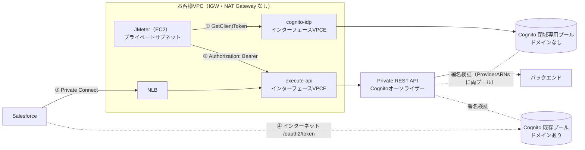

# Cognito M2Mアクセストークンの閉域取得 と Private API Gateway × JMeter 検討結果・運用提案

- **作成日**：2026-10-18
- **対象**：Amazon Cognito ユーザープール（M2M / client credentials）、Amazon API Gateway Private REST API（Salesforce連携・NLB→VPCエンドポイント経由）、Apache JMeter による試験
- **リージョン**：ap-northeast-1（東京）を例に記載
- **情報の鮮度**：2026年10月18日時点のAWS公式ドキュメント・発表（2026-08-31 GetClientToken 追加、2025-11-07 Cognito PrivateLink 対応 など）を反映
- **記号の意味**：◎=推奨／○=可能／△=条件付き・暫定／×=不可・非推奨。「根拠」列は 公式=AWS公式記載、検証記事=第三者の実機検証、推定=本書の推論（要PoC）

> **ひとことで言うと**  
> 2026年8月31日に追加された新API「GetClientToken」と Cognito の VPCエンドポイント（PrivateLink）を使えば、インターネットを一切通らずにM2Mアクセストークンを取得できる。ただし「ドメインを持たないユーザープール」であることが絶対条件。現行（ドメインあり）のプールのままでは不可のため、閉域専用ユーザープールを新設し、Private API の Cognito オーソライザーに追加する構成を推奨する。

## 目次

1. 結論サマリー — 質問への答え（YES/NO と条件）、推奨案、やってはいけないこと
2. やさしい解説 — 小学生にもわかる「遊園地とリストバンド」のたとえ話
3. 歴史と背景 — OAuth 2.0 から GetClientToken までの年表と、必要になった経緯
4. 経路比較 — トークン取得方法7案の比較（公衆回線を通るか、NAT要否、ドメイン要否など）
5. 推奨構成 — 推奨構成の図と通信フロー、必要なVPCエンドポイント
6. 実装手順 — 閉域専用ユーザープール作成からJMeter組込みまでの手順とコマンド
7. CLI取得 — AWS CLI / curl / PowerShell での取得方法と API 呼び出し
8. シェル取得 — キャッシュ付きトークン取得スクリプト、JMeter実行スクリプト
9. JMeter取得 — JMeterのテスト計画構成、設定値、Groovyコード、実行方法
10. SDK取得 — Python / Java / Node.js / PowerShell の実装例
11. コスト試算 — トークン取得回数とコスト・クォータの試算（入力セルを変えると再計算）
12. 運用提案 — 運用設計の提案とロードマップ
13. リスク注意点 — 注意点・リスクと対策（根拠の確度つき）
14. PoC試験項目 — PoCで確認すべき試験項目（結果記入欄つき）
15. 用語集 — 用語のやさしい説明
16. 参考資料 — 参照したAWS公式ドキュメント・発表・検証記事

## 1. 結論サマリー

### Q1. AWS SDK（API）でアクセストークンを取得すれば、パブリック経路に出なくても取得できるか？

**判定：△ 条件付きでYES**

- **結論**：2026-08-31 に追加された cognito-idp の新API「GetClientToken」なら、インターフェース型VPCエンドポイント（com.amazonaws.&lt;region>.cognito-idp）経由で、IGW・NATなしにM2Mアクセストークンを取得できる。
- **条件・理由**：【絶対条件】ユーザープールにドメインが設定されていないこと。AWS公式ドキュメントに「ドメインが存在するユーザープールは、VPCエンドポイントを通るリクエストが一切完了しない（PrivateLinkと非互換）」と明記されている。現行の /oauth2/token（client credentials grant）はドメインが前提で、PrivateLink の対象外。したがって“現行のプールのまま”SDKに切り替えても閉域では取得できない。

### Q1補足. 2026年8月より前はどうだったか？

**判定：× 不可だった**

- **結論**：SDK（cognito-idp API）にはM2M用の操作が無く、M2Mトークンはドメインの /oauth2/token からしか取得できなかった。2025-11-07 に Cognito が PrivateLink に対応したが、client credentials は対象外だった。
- **条件・理由**：InitiateAuth / AdminInitiateAuth はVPCE経由で呼べるが、人（ユーザー）用の認証であり、アクセストークンのスコープは aws.cognito.signin.user.admin のみ（カスタムスコープが付かない）。M2Mの代替にはならない。

### Q2. Private API Gateway（REST）へのトークン取得〜JMeterからの呼び出しを、公衆回線を全く経由せずに実現できるか？

**判定：○ YES（構成追加が必要）**

- **結論**：JMeterをVPC内のプライベートサブネット（IGW・NATなし）のEC2で動かす。①トークン：GetClientToken → cognito-idp VPCE → 閉域専用ユーザープール（ドメインなし）。②API：execute-api VPCE → Private REST API。③既存のCognitoオーソライザーに閉域専用プールを追加（ProviderARNsは複数指定可）。
- **条件・理由**：トークンの署名検証はAPI Gateway内部で行われるため、クライアント側に追加の外部通信は不要。JMeterをオンプレミスで動かす場合は Direct Connect が必要（Site-to-Site VPN はインターネット上の暗号化トンネルなので「公衆回線を全く経由しない」には当たらない）。

### Q3. Salesforce 側の既存連携に影響はあるか？

**判定：○ 影響なし（推奨案A）**

- **結論**：推奨案Aは既存のユーザープール（ドメイン・/oauth2/token）に手を入れないため、Salesforce の Named Credential／トークン取得は従来どおり。
- **条件・理由**：注意：M2Mトークン取得のクォータ（ClientAuthentication：150 RPS、引き上げ不可）はアカウント×リージョン単位で全プール共有。JMeterの誤設定（リクエスト毎にトークン取得）が本番Salesforceのトークン取得を巻き込んでスロットリングさせる危険があるため、必ずトークンを使い回す設計にする。

### 推奨案

| 項目 | 内容 |
|---|---|
| 推奨案 | 案A：閉域専用ユーザープール（ドメインなし）を新設 ＋ GetClientToken ＋ cognito-idp VPCエンドポイント ＋ 既存Cognitoオーソライザーへのプール追加 |
| 理由1 | インターネット（公衆回線）・IGW・NAT Gateway を一切使わずに、トークン取得から API 呼び出しまで完結する |
| 理由2 | 既存のSalesforce連携（ドメイン＋/oauth2/token）を一切変更しないため、本番影響がない |
| 理由3 | トークンは本番と同じ「Cognitoアクセストークン＋カスタムスコープ」で、オーソライザーも同じものを使うため、負荷試験の再現性が高い |
| 暫定案 | 案C：NAT Gateway 経由で既存の /oauth2/token を呼ぶ（AWSのネットワーク内に留まるがパブリックIP経路。「公衆回線を全く通さない」要件の解釈次第） |
| 将来案 | 案B：Salesforce も GetClientToken へ移行し、既存プールのドメインを削除して全面的に閉域化（Apex実装と切替計画が必要・要PoC） |

### やってはいけないこと

1. ドメインがある既存プールに対して VPCE 経由で GetClientToken を呼ぶ（必ず失敗する）
2. 閉域専用プールにドメインを追加する（その瞬間から VPCE 経由のリクエストがすべて失敗する）
3. JMeter で API リクエストのたびにトークンを取得する（150 RPS の共有クォータ超過・課金爆発・本番Salesforceへの巻き込み）
4. クライアントシークレットを .jmx ファイルやGitリポジトリに保存する
5. VPC内に「ドメインありプール」を使う別システムがあるのに、cognito-idp VPCE のプライベートDNSを安易に有効化する（そのシステムのCognito API呼び出しがVPCE経由になり失敗する）

## 2. やさしい解説（小学生にもわかる版）

### おはなし：リストバンドを大通りに出ずにもらうには？

1. 遊園地（API）に入るには、受付（Cognito）でもらうリストバンド（アクセストークン）が必要です。
2. これまで、ロボット用のリストバンド窓口（/oauth2/token）は、大通り（インターネット）に面した表玄関（ドメイン）にしかありませんでした。
3. 遊園地そのものは敷地の中にあり、地下通路（VPCエンドポイント）からしか入れません。なのにリストバンドだけは、いったん大通りに出てもらいに行く必要がありました。
4. 2025年11月、受付の建物にも地下通路がつながりました。でも、ロボット用の窓口だけは表玄関のままでした。
5. 2026年8月、地下通路側に新しいロボット用窓口（GetClientToken）ができました。これで大通りに出ずにリストバンドがもらえます。
6. ただし決まりがあります。「表玄関を開けている受付は、地下通路からは使えない」。今の受付は Salesforce のために表玄関を開けているので、地下通路からは使えません。
7. そこで、表玄関のない“地下通路専用の受付”（閉域専用ユーザープール）をもう一つ作ります。入口の係員（オーソライザー）には、両方の受付のハンコを覚えてもらいます。
8. これで JMeter ロボットは、一度も大通りに出ずに、リストバンドをもらって遊園地（Private API）を試せます。リストバンドは1時間使えるので、毎回もらいに行かず使い回すのがお約束です。

### ことばのたとえ

| ことば（技術用語） | たとえると… | ほんとうの意味 |
|---|---|---|
| API（Private REST API） | 敷地の中にある遊園地 | Salesforce や JMeter から呼ばれる、VPCの中からしか入れない API。 |
| アクセストークン | 遊園地のリストバンド | 「この機械は入ってよい」と証明する JWT。有効期限つき（既定60分、5分〜1日で設定可）。 |
| Cognito | リストバンドを配る受付 | AWS の認証サービス。トークンを発行し、電子のハンコ（署名）を押す。 |
| クライアントID／シークレット | 会員番号と合言葉 | 人ではなく「機械（プログラム）」が持つ ID とパスワード。 |
| M2M（Machine to Machine） | ロボット同士のやりとり | 人がログインせず、システム同士が直接通信すること（Salesforce→AWS、JMeter→AWS）。 |
| スコープ | リストバンドの色 | 「読むだけ」「書いてもよい」など、何をしてよいかの範囲（例：sfdc-api/read）。 |
| ユーザープールのドメイン | 受付の表玄関（大通り側の入口） | /oauth2/token 窓口がある入口。インターネット側にしか開いていない。 |
| インターネット（公衆回線） | 大通り | だれでも通れる公共の道。 |
| VPC | 自分の会社の敷地（塀で囲まれている） | AWS上の自分専用ネットワーク。 |
| VPCエンドポイント（PrivateLink） | 受付や遊園地に直結する地下通路 | 大通りに出ずに AWS のサービスへ行ける専用の通り道。 |
| NAT Gateway | 敷地から大通りへ出る門 | VPC内から外（パブリックIP）へ出るための出口。 |
| GetClientToken | 地下通路側にできた新しい受付窓口（2026年8月〜） | ドメインなしでM2Mトークンを発行する新API。SDK・CLI・HTTPで呼べる。 |
| ドメインがあると地下通路NGのルール | 「表玄関を開けている受付は、地下通路から使えない」決まり | ドメインがあるユーザープールは、VPCエンドポイント経由のリクエストが完了しない（AWS公式）。 |
| Cognitoオーソライザー | 遊園地の入口でリストバンドを確かめる係員 | API Gateway がトークンの署名・期限・スコープを確認する機能。複数の受付のハンコを覚えられる。 |
| NLB | 外のお客さん（Salesforce）を地下通路へ案内する係 | Salesforce Private Connect からの通信を execute-api VPCE へ中継するロードバランサー。 |
| JMeter | 「たくさんのお客さんが一度に来たら？」を試すロボット | 負荷試験ツール。大量のAPIリクエストを送って性能を測る。 |

## 3. 歴史と背景

### 年表

| 年月 | 出来事 | なにが変わった？（やさしく） | 本件との関係 |
|---|---|---|---|
| 2012-10 | OAuth 2.0（RFC 6749）発行。4.4節で client credentials grant を定義 | 機械が合言葉でリストバンドをもらう世界共通ルールができた | 現行M2M方式（/oauth2/token）の土台 |
| 2014-07 | Amazon Cognito 提供開始（IDプール／同期） | AWSに受付係が生まれた | — |
| 2015-05 | JWT（RFC 7519）発行 | ハンコ付きのリストバンド形式が標準化された | Cognitoトークンの形式 |
| 2015-07 | Amazon API Gateway 提供開始 | AWSに遊園地の入口ができた | — |
| 2016-07 | Cognito ユーザープール 一般提供（2016-04 ベータ） | 会員名簿を持つ受付になった | M2Mアプリクライアントの器 |
| 2017-08 | ユーザープールで OAuth 2.0・ホストUI・フェデレーションが一般提供 | 表玄関（ドメイン）と /oauth2/token 窓口ができた | 現行Salesforce連携のトークン取得方式 |
| 2017-09 | Network Load Balancer 提供開始 | 高速な案内係が登場 | Salesforce→VPCE の中継 |
| 2017-11 | AWS PrivateLink（インターフェース型VPCエンドポイント）提供開始 | 地下通路ができた | 閉域化の基盤技術 |
| 2018-06 | API Gateway プライベートAPI 提供開始 | 敷地の中だけの遊園地が作れるようになった | 現行の Private REST API |
| 2020（Summer '20） | Salesforce Private Connect 提供開始 → 2022-11 全世界提供 | Salesforce から地下通路でAWSへ来られるようになった | 現行の Salesforce→NLB→VPCE 構成の背景 |
| 2023-12 | Pre token generation トリガー V2（アクセストークンのカスタマイズ） | リストバンドに追記できるようになった（人のトークン） | — |
| 2024-05 | M2Mの従量課金を開始（当初はアプリクライアント数＋トークン要求数） | リストバンド発行が有料に。使い回しが大切に | JMeterで毎回取得は厳禁 |
| 2024-11-21 | プライベートREST APIのカスタムドメイン名に対応 | 敷地内の遊園地にわかりやすい名前を付けられる | NLB／証明書設計の選択肢 |
| 2024-11-22 | Cognito 機能プラン（Lite／Essentials／Plus）とマネージドログイン | 受付のサービスプランが3段階に | V3トリガーは Essentials／Plus |
| 2025-04 | M2Mでクライアントメタデータ・アクセストークンカスタマイズ（V3_0）に対応 | ロボット用リストバンドにも追記できるように | 必要時のみ利用 |
| 2025-11-03 | M2Mのアプリクライアント課金を廃止（トークン要求数のみ課金） | 窓口の数ではお金がかからなくなった | 閉域専用クライアント追加の費用は要求数のみ |
| **2025-11-07** | Cognito ユーザープールが AWS PrivateLink に対応。ただし client credentials・マネージドログイン等は対象外 | 受付に地下通路がついたが、ロボット窓口は表玄関のみ | 「パブリック経路でしか取得できない」現状の正体 |
| **2026-08-31** | GetClientToken API 追加（ドメイン不要・SDK/CLI/API・WAF・PrivateLink 対応） | 地下通路側にロボット窓口ができた | 本検討の決め手 |
| 2026-09-01 | 国内で検証記事公開（AWS CLI v2.36.34／2.36.36 で動作確認） | 実際に動くことが確かめられた | CLIバージョン要件の目安 |

### なぜ必要になったのか（経緯）

- **なぜ閉域化したいのか**：金融・公共・個人情報を扱うシステムでは「インターネットを経由しない」ことがセキュリティ基準や監査で求められることが多い。Salesforce と AWS を Private Connect でつなぐのもこのため。
- **何が“片手落ち”だったのか**：API 本体は Private API＋PrivateLink で閉域化できていたが、入場券（トークン）の発行だけはインターネット側の表玄関（ドメイン）にしかなかった。
- **従来の回避策と悩み**：NAT Gateway を置いて外に出す（費用・監査での説明が必要）、またはトークンを代理取得するブローカーを自作する（実装・保守の手間）しかなかった。
- **2025年11月の前進**：Cognito ユーザープールが PrivateLink に対応。しかし M2M（client credentials）は対象外で、M2M の閉域化は実現しなかった。
- **2026年8月の解決**：GetClientToken がドメイン不要の“普通のAWS API”として登場し、PrivateLink 経由で M2M トークンを取得できるようになった。
- **残る条件**：「ドメインがあるプールは PrivateLink と非互換」というルールが残るため、ドメインが必要な既存連携（Salesforce の /oauth2/token）とは、ユーザープールを分ける必要がある。

## 4. トークン取得経路の比較

| 案 | 取得方法 | 通信経路 | 公衆回線を通るか | IGW/NAT | ドメイン | Salesforce影響 | カスタムスコープ | 難易度 | 評価 | コメント |
|---|---|---|---|---|---|---|---|---|---|---|
| A | GetClientToken＋cognito-idp VPCE＋閉域専用プール | VPC → cognito-idp VPCE → Cognito（閉域専用プール） | 通らない | 不要 | なし（必須条件） | なし | ○ | 中 | ◎ 推奨 | ドメインのない新プールを作り、既存オーソライザーに追加。本番と同じ形式のトークンで試験できる。 |
| B | 既存プールのドメイン削除＋全クライアントを GetClientToken へ移行 | VPC → VPCE → Cognito（既存プール） | 通らない（Salesforce側は要PoC） | 不要 | 削除が必要 | 大（Apex実装・切替） | ○ | 高 | ○ 将来像 | 単一プールで全面閉域化。Salesforce の Named Credential は標準OAuthエンドポイント前提のため Apex での独自実装が必要。 |
| C | 既存 /oauth2/token を NAT Gateway 経由で呼ぶ | VPC → NAT GW → パブリックIP → Cognitoドメイン | AWS網内に留まるがパブリックIP経路 | 必要 | 必要 | なし | ○ | 低 | △ 暫定 | 最も簡単。AWS公式FAQではAWS内のパブリックIP間通信はAWSのネットワーク内に留まるとされるが、「公衆回線を全く通さない」要件の解釈に依存。 |
| D | 既存プール（ドメインあり）に VPCE 経由で GetClientToken | VPC → VPCE → Cognito（既存プール） | — | 不要 | あり | なし | — | — | × 動かない | ドメインがあるプールは VPCE 経由のリクエストが完了しない（AWS公式）。 |
| E | トークンブローカー（VPC外Lambda等が /oauth2/token を代理取得） | VPC → Lambda/API VPCE → (AWS側から) Cognitoドメイン | クライアント側は通らない／ブローカー側はパブリックエンドポイント | クライアント側は不要 | 必要 | なし | ○ | 中 | △ 旧回避策 | GetClientToken 登場前の定番回避策。現在は案Aのほうが単純。 |
| F | InitiateAuth／AdminInitiateAuth（サービス用ユーザー） | VPC → VPCE → Cognito | 通らない | 不要 | なし | なし | ×（user.admin のみ） | 中 | × 非推奨 | 人用の認証。カスタムスコープが付かず、パスワード管理・MAU課金も発生。M2Mの代替にならない。 |
| G | 試験用に認可方式を IAM（SigV4）や Lambdaオーソライザーへ変更 | VPC → execute-api VPCE | 通らない | 不要 | — | 設定差分が発生 | — | 中 | × 試験目的では非推奨 | 本番（Cognitoオーソライザー）と認可方式が変わり、負荷試験の再現性が下がる。 |

※ 案C の「パブリックIP経路」：AWS の VPC FAQ では、AWS 内のパブリックIP間通信やパブリックなAWSサービスエンドポイントへの通信は AWS のネットワーク内を通るとされる。ただし IGW／NAT とパブリックIPを使うため、社内基準の「公衆回線を経由しない」に該当するかは基準の定義次第。

## 5. 推奨構成（案A）



```text
① トークン取得（新規）：JMeter (EC2・プライベートサブネット) → cognito-idp インターフェースVPCE → Cognito 閉域専用プール (ドメインなし) GetClientToken
② API呼び出し（新規）：JMeter (EC2・プライベートサブネット) → execute-api インターフェースVPCE → Private REST API (Cognitoオーソライザー) → バックエンド
③ Salesforce（既存）：Salesforce → Private Connect (PrivateLink) → NLB → execute-api VPCE → Private REST API
④ Salesforceのトークン（既存）：Salesforce → インターネット → Cognito 既存プール (ドメインあり) /oauth2/token
```

### 通信フロー

| 手順 | 送り元 | 送り先 | 経由 | 内容 | 公衆回線 |
|---|---|---|---|---|---|
| 1 | JMeter（EC2） | Secrets Manager | secretsmanager VPCE | クライアントID／シークレットを取得（IAMロール。任意） | 通らない |
| 2 | JMeter（EC2） | Cognito 閉域専用プール | cognito-idp VPCE | POST /  X-Amz-Target: AWSCognitoIdentityProviderService.GetClientToken | 通らない |
| 3 | Cognito | JMeter（EC2） | cognito-idp VPCE | AccessToken（JWT）・ExpiresIn（例 3600秒）・TokenType=Bearer を返却 | 通らない |
| 4 | JMeter（EC2） | Private REST API | execute-api VPCE | Authorization: Bearer &lt;AccessToken> を付けて API 呼び出し | 通らない |
| 5 | API Gateway | （内部処理） | — | Cognitoオーソライザーが署名・有効期限・scope を検証（ProviderARNs に既存プール＋閉域専用プール） | 通らない |
| 6 | API Gateway | バックエンド | 統合（Lambda／VPCリンク等） | 既存の統合処理 | 通らない |
| 参考 | Salesforce | Private REST API | Private Connect → NLB → execute-api VPCE | 既存どおり（トークンは既存プールの /oauth2/token から取得） | API呼び出しは通らない |

### 必要な VPC エンドポイント

| VPCエンドポイント（サービス名） | 種類 | 要否 | 用途・注意 |
|---|---|---|---|
| com.amazonaws.ap-northeast-1.cognito-idp | Interface | 必須（新規） | GetClientToken 用。SG は JMeter からの TCP 443 のみ許可。プライベートDNSの影響範囲に注意。 |
| com.amazonaws.ap-northeast-1.execute-api | Interface | 必須（既存） | Private REST API 呼び出し用。JMeter の VPC が別なら API のリソースポリシーにその VPCE を追加。 |
| com.amazonaws.ap-northeast-1.secretsmanager | Interface | 推奨 | クライアントシークレットの安全な取得。 |
| com.amazonaws.ap-northeast-1.ssm / ssmmessages / ec2messages | Interface | 推奨 | Session Manager で踏み台なしに EC2 を操作（ec2messages は旧エージェント向け）。 |
| com.amazonaws.ap-northeast-1.logs / monitoring | Interface | 推奨 | CloudWatch Logs への試験ログ送信、メトリクス送信。 |
| com.amazonaws.ap-northeast-1.s3 | Gateway | 推奨 | JMeter本体・プラグイン・SDKのjar・試験結果の受け渡し（閉域なのでインターネットからダウンロードできない）。 |
| com.amazonaws.ap-northeast-1.sts | Interface | 任意 | SDK で AssumeRole する場合のみ。 |

## 6. 実装手順（案A）

### Step 0：前提確認：CLI/SDK が GetClientToken に対応しているか

```bash
aws --version
aws cognito-idp get-client-token help
```

- help が表示されること（検証記事では aws-cli/2.36.34 以降で確認）。閉域環境では新しいインストーラーを S3 経由で搬入する。

### Step 1：閉域専用ユーザープールを作成（ドメインは作らない）

```bash
aws cognito-idp create-user-pool \
  --region ap-northeast-1 \
  --pool-name m2m-private-pool \
  --user-pool-tier ESSENTIALS
```

- M2M専用プールは MAU が発生しない。V3トリガー（トークンカスタマイズ）を使わないなら機能プランは LITE でもよい。

### Step 2：リソースサーバーとカスタムスコープを作成（既存プールと同じ識別子・スコープ名）

```bash
aws cognito-idp create-resource-server \
  --user-pool-id ap-northeast-1_PRIVATE01 \
  --identifier sfdc-api \
  --name "SFDC Integration API" \
  --scopes ScopeName=read,ScopeDescription=read ScopeName=write,ScopeDescription=write
```

- オーソライザーはスコープ文字列（例 sfdc-api/read）で照合するため、既存プールと完全に同じ文字列にそろえる。

### Step 3：M2M専用アプリクライアントを作成（ALLOW_CLIENT_TOKEN_AUTH のみ・シークレット生成）

```bash
aws cognito-idp create-user-pool-client \
  --user-pool-id ap-northeast-1_PRIVATE01 \
  --client-name jmeter-m2m \
  --generate-secret \
  --explicit-auth-flows ALLOW_CLIENT_TOKEN_AUTH \
  --allowed-o-auth-scopes "sfdc-api/read" "sfdc-api/write" \
  --access-token-validity 60 \
  --token-validity-units AccessToken=minutes
```

- ユーザー認証フローと併用すると「ALLOW_CLIENT_TOKEN_AUTH is not a permitted ExplicitAuthFlow when user auth-flows are enabled.」で失敗する。

### Step 4：シークレットを Secrets Manager に格納

```bash
SECRET=$(aws cognito-idp describe-user-pool-client \
  --user-pool-id ap-northeast-1_PRIVATE01 --client-id <CLIENT_ID> \
  --query 'UserPoolClient.ClientSecret' --output text)
aws secretsmanager create-secret --name /jmeter/cognito/m2m \
  --secret-string "$(jq -n --arg id <CLIENT_ID> --arg s "$SECRET" \
      '{client_id: $id, client_secret: $s}')"
unset SECRET
```

- シークレットを画面・ログ・履歴に残さない。アプリクライアントは有効なシークレットを最大2つ持てるので、無停止ローテーションが可能。

### Step 5：cognito-idp インターフェースVPCエンドポイントを作成

```bash
aws ec2 create-vpc-endpoint \
  --vpc-id vpc-0123456789abcdef0 \
  --vpc-endpoint-type Interface \
  --service-name com.amazonaws.ap-northeast-1.cognito-idp \
  --subnet-ids subnet-aaaa subnet-cccc \
  --security-group-ids sg-vpce-cognito \
  --private-dns-enabled
```

- 同じVPCで「ドメインありプール」のCognito APIを呼ぶシステムがある場合は --no-private-dns-enabled とし、JMeter側で VPCE 固有DNS名を指定する。

### Step 6：VPCエンドポイントポリシーで閉域専用プールの GetClientToken のみ許可

```json
{
  "Version": "2012-10-17",
  "Statement": [{
    "Effect": "Allow",
    "Principal": "*",
    "Action": ["cognito-idp:GetClientToken"],
    "Resource": "arn:aws:cognito-idp:ap-northeast-1:<ACCOUNT_ID>:userpool/ap-northeast-1_PRIVATE01"
  }]
}
```

- GetClientToken は IAM で認可されない（署名なし操作）ため Principal は "*" とし、Resource で対象プールを絞る。

### Step 7：API Gateway の Cognito オーソライザーに閉域専用プールを追加し、再デプロイ

```yaml
# CloudFormation の例（AWS::ApiGateway::Authorizer）
Type: COGNITO_USER_POOLS
IdentitySource: method.request.header.Authorization
ProviderARNs:
  - arn:aws:cognito-idp:ap-northeast-1:<ACCOUNT_ID>:userpool/<既存プールID>
  - arn:aws:cognito-idp:ap-northeast-1:<ACCOUNT_ID>:userpool/ap-northeast-1_PRIVATE01
```

- コンソールの場合：API → オーソライザー → 編集 → ユーザープールを追加 → 保存 → API をデプロイ。メソッドの認可スコープ（sfdc-api/read など）は変更不要。

### Step 8：閉域であることと疎通を確認

```bash
curl -m 5 https://checkip.amazonaws.com   # タイムアウトすること（外に出られない）
dig +short cognito-idp.ap-northeast-1.amazonaws.com   # 10.x 等のプライベートIP
./get_token.sh | cut -c1-20   # トークン先頭のみ表示
curl -s -o /dev/null -w '%{http_code}\n' \
  -H "Authorization: Bearer $(./get_token.sh)" \
  https://<api-id>.execute-api.ap-northeast-1.amazonaws.com/prod/accounts
```

- 200 が返ること。VPC Flow Logs でインターネット向けの通信が無いことも確認する。

### Step 9：JMeter のテスト計画に組み込み（09_JMeter取得 シート参照）

```bash
jmeter -n -t private_api_load.jmx -q /dev/shm/secret.properties -l result.jtl
```

- setUp スレッドグループで1回取得し、プロパティで全スレッドに共有。長時間試験は50分ごとに更新。

### Step 10：監視・ガードレールを設定（12_運用提案 シート参照）

```bash
RCP: cognito-idp:CreateUserPoolDomain を閉域専用プールに対して Deny
CloudWatch: ClientAuthentication カテゴリの ThrottleCount を監視
```

- 閉域専用プールに誤ってドメインが付くと、VPCE 経由のトークン取得が全停止するため、予防と検知の両方を用意する。

## 7. 取得方法：AWS CLI／curl／PowerShell

### A. 基本：AWS CLI でトークンだけを取り出す

IAM の資格情報は不要（GetClientToken は署名なしの操作）。プライベートDNS有効の VPCE があれば、この既定のエンドポイント名のまま VPCE に向かう。

```bash
aws cognito-idp get-client-token \
  --region ap-northeast-1 \
  --client-id "$CLIENT_ID" \
  --secret "$CLIENT_SECRET" \
  --scopes "sfdc-api/read" \
  --query 'ClientAuthenticationResult.AccessToken' \
  --output text
```

### B. プライベートDNS無効の場合：VPCE固有のDNS名を指定

VPCE の DNS 名は「aws ec2 describe-vpc-endpoints」で確認できる。

```bash
aws cognito-idp get-client-token \
  --region ap-northeast-1 \
  --endpoint-url "https://vpce-0123456789abcdef0-abcdefgh.cognito-idp.ap-northeast-1.vpce.amazonaws.com" \
  --client-id "$CLIENT_ID" --secret "$CLIENT_SECRET" \
  --scopes "sfdc-api/read" \
  --query 'ClientAuthenticationResult.AccessToken' --output text
```

### C. シークレットをコマンドライン引数に出さない（推奨）

--secret を引数で渡すと ps コマンドやシェル履歴から見える。権限600の一時ファイル（メモリ上の /dev/shm）経由で渡し、すぐ消す。

```bash
umask 077
REQ=$(mktemp -p /dev/shm req_XXXX.json)
trap 'rm -f "$REQ"' EXIT
aws secretsmanager get-secret-value --region ap-northeast-1 \
  --secret-id /jmeter/cognito/m2m --query SecretString --output text \
| jq '{ClientId: .client_id, Secret: .client_secret, Scopes: ["sfdc-api/read"]}' > "$REQ"

TOKEN=$(aws cognito-idp get-client-token --region ap-northeast-1 \
  --cli-input-json "file://$REQ" \
  --no-sign-request \
  --query 'ClientAuthenticationResult.AccessToken' --output text)
```

### D. curl だけで GetClientToken を呼ぶ（AWS CLI 不要）

AWS API は「POST / ＋ X-Amz-Target ヘッダ＋JSON本文」で呼べる。署名なし操作なので curl だけで完結する。

```bash
curl -sS https://cognito-idp.ap-northeast-1.amazonaws.com/ \
  -H "Content-Type: application/x-amz-json-1.1" \
  -H "X-Amz-Target: AWSCognitoIdentityProviderService.GetClientToken" \
  --data-binary @"$REQ" \
| jq -r '.ClientAuthenticationResult.AccessToken'

# 応答の形
# {"ClientAuthenticationResult":{"AccessToken":"eyJ...","ExpiresIn":3600,"TokenType":"Bearer"}}
```

### E. Private REST API を呼ぶ（3通りのURL）

①プライベートDNS有効時の既定URL、②VPCE固有DNS名＋x-apigw-api-id ヘッダ、③API に VPCE を関連付けた場合の Route 53 エイリアス名。

```bash
# ① プライベートDNS有効
curl -s https://<api-id>.execute-api.ap-northeast-1.amazonaws.com/prod/accounts \
  -H "Authorization: Bearer $TOKEN"

# ② VPCE固有DNS名（プライベートDNS無効でも可）
curl -s https://vpce-0aaa-bbbb.execute-api.ap-northeast-1.vpce.amazonaws.com/prod/accounts \
  -H "x-apigw-api-id: <api-id>" \
  -H "Authorization: Bearer $TOKEN"

# ③ VPCEをAPIに関連付けた場合のエイリアス
curl -s https://<api-id>-<vpce-id>.execute-api.ap-northeast-1.amazonaws.com/prod/accounts \
  -H "Authorization: Bearer $TOKEN"
```

### F. トークンの中身（クレーム）を確認する

JWT の2番目の部分（ペイロード）を base64url デコードする。scope・client_id・exp・iss を確認。

```bash
jwt_payload() {
  local p; p=$(cut -d. -f2 <<<"$1" | tr '_-' '/+')
  while (( ${#p} % 4 )); do p+="="; done
  base64 -d <<<"$p" | jq '{iss, client_id, token_use, scope, exp: (.exp|todate)}'
}
jwt_payload "$TOKEN"
```

### G. PowerShell（AWS Tools for PowerShell）

コマンドレットは Get-CGIPClientToken。既定の出力は ClientAuthenticationResultType。

```powershell
Import-Module AWS.Tools.CognitoIdentityProvider
$r = Get-CGIPClientToken -ClientId $env:CLIENT_ID -Secret $env:CLIENT_SECRET `
       -Scope "sfdc-api/read" -Region ap-northeast-1
       # プライベートDNS無効時: -EndpointUrl "https://vpce-....cognito-idp.ap-northeast-1.vpce.amazonaws.com"
$r.AccessToken
Invoke-RestMethod -Uri "https://<api-id>.execute-api.ap-northeast-1.amazonaws.com/prod/accounts" `
  -Headers @{ Authorization = "Bearer $($r.AccessToken)" }
```

### H. 参考：現行方式（ドメインの /oauth2/token、インターネット経由）

Salesforce が現在使っている方式。ドメインが必要で、VPCE 経由では呼べない。比較のために記載。

```bash
curl -sS -X POST "https://<prefix>.auth.ap-northeast-1.amazoncognito.com/oauth2/token" \
  -u "$CLIENT_ID:$CLIENT_SECRET" \
  -H "Content-Type: application/x-www-form-urlencoded" \
  -d "grant_type=client_credentials&scope=sfdc-api%2Fread" \
| jq -r '.access_token' 
```

## 8. 取得方法：シェルスクリプト

前提：Amazon Linux 2023 等（bash・curl 7.76以上・jq・AWS CLI v2）。シークレットは Secrets Manager（VPCE経由）から取得。

### get_token.sh：キャッシュ付きトークン取得（curl＋jq、AWS CLIはシークレット取得のみ）

有効期限の5分前まではキャッシュを返すので、何度呼んでも Cognito への要求は最小限。シークレットは標準入力経由で curl に渡し、プロセス一覧に出さない。

```bash
#!/usr/bin/env bash
# get_token.sh : GetClientToken で M2M アクセストークンを取得（キャッシュ付き）
set -euo pipefail

REGION="${REGION:-ap-northeast-1}"
# プライベートDNS有効なら既定名のまま VPCE へ。無効なら VPCE 固有DNS名を指定する
COGNITO_ENDPOINT="${COGNITO_ENDPOINT:-https://cognito-idp.${REGION}.amazonaws.com/}"
SCOPES="${SCOPES:-sfdc-api/read}"            # 複数ある場合は空白区切り
SECRET_ID="${SECRET_ID:-/jmeter/cognito/m2m}"
CACHE_FILE="${CACHE_FILE:-/dev/shm/cognito_m2m_token.json}"
REFRESH_MARGIN_SEC="${REFRESH_MARGIN_SEC:-300}"

now() { date +%s; }

# 1) キャッシュが有効ならそのまま返す
if [[ -s "$CACHE_FILE" ]]; then
  exp=$(jq -r '.expires_at' "$CACHE_FILE")
  if (( exp - REFRESH_MARGIN_SEC > $(now) )); then
    jq -r '.access_token' "$CACHE_FILE"
    exit 0
  fi
fi

# 2) クライアントID／シークレットを Secrets Manager（VPCE経由）から取得
creds=$(aws secretsmanager get-secret-value --region "$REGION" \
          --secret-id "$SECRET_ID" --query SecretString --output text)

# 3) GetClientToken を直接呼ぶ（署名不要）。本文は標準入力で渡す
resp=$(jq -c --arg sc "$SCOPES" \
         '{ClientId: .client_id, Secret: .client_secret, Scopes: ($sc | split(" "))}' <<<"$creds" \
       | curl -sS --fail-with-body --max-time 10 \
           -H "Content-Type: application/x-amz-json-1.1" \
           -H "X-Amz-Target: AWSCognitoIdentityProviderService.GetClientToken" \
           --data-binary @- "$COGNITO_ENDPOINT") || {
  # 失敗時の本文は {"__type":"NotAuthorizedException","message":"..."} の形（シークレットは含まれない）
  echo "GetClientToken failed: ${resp:-no response}" >&2
  exit 1
}

token=$(jq -r '.ClientAuthenticationResult.AccessToken' <<<"$resp")
expires_in=$(jq -r '.ClientAuthenticationResult.ExpiresIn' <<<"$resp")

# 4) キャッシュ保存（権限600）
umask 077
jq -n --arg t "$token" --argjson e "$(( $(now) + expires_in ))" \
  '{access_token: $t, expires_at: $e}' > "$CACHE_FILE"
echo "$token"
```

### call_api.sh：取得したトークンで Private REST API を呼ぶ

401 のときはキャッシュを消して1回だけ取り直す（期限切れ対策）。

```bash
#!/usr/bin/env bash
# call_api.sh : Private REST API 呼び出し（401 時は1回だけトークン再取得）
set -euo pipefail
API_URL="${API_URL:-https://<api-id>.execute-api.ap-northeast-1.amazonaws.com/prod/accounts}"
CACHE_FILE="${CACHE_FILE:-/dev/shm/cognito_m2m_token.json}"

call() {
  curl -sS -o /tmp/api_body.json -w '%{http_code}' \
    -H "Authorization: Bearer $(./get_token.sh)" "$API_URL"
}

code=$(call)
if [[ "$code" == "401" ]]; then
  rm -f "$CACHE_FILE"
  code=$(call)
fi
echo "HTTP $code"
cat /tmp/api_body.json
```

### run_jmeter.sh：シークレットを一時プロパティファイルで JMeter に渡して実行

-q で追加プロパティファイルを読み込ませる。シークレットを .jmx やコマンドライン引数に書かない。

```bash
#!/usr/bin/env bash
# run_jmeter.sh : JMeter を非GUIモードで実行
set -euo pipefail
REGION=ap-northeast-1
SECRET_ID=/jmeter/cognito/m2m
TS=$(date +%Y%m%d_%H%M%S)

umask 077
PROPS=$(mktemp -p /dev/shm jmeter_XXXX.properties)
trap 'rm -f "$PROPS"' EXIT
aws secretsmanager get-secret-value --region "$REGION" --secret-id "$SECRET_ID" \
  --query SecretString --output text \
| jq -r '"client_id=\(.client_id)\nclient_secret=\(.client_secret)"' > "$PROPS"

jmeter -n -t ./plan/private_api_load.jmx \
  -q "$PROPS" \
  -Jcognito_host="cognito-idp.${REGION}.amazonaws.com" \
  -Japi_host="<api-id>.execute-api.${REGION}.amazonaws.com" \
  -Jstage=prod -Jscopes="sfdc-api/read" \
  -Jrefresh_ms=3000000 \
  -l "./result/result_${TS}.jtl" -e -o "./result/report_${TS}"
```

### AWS CLI 版（get_token_cli.sh）：curl を使わず CLI で取得する場合

CLI のほうが社内標準に合う場合はこちら。--no-sign-request で資格情報が無くても動く。

```bash
#!/usr/bin/env bash
set -euo pipefail
REGION=ap-northeast-1
umask 077
REQ=$(mktemp -p /dev/shm req_XXXX.json); trap 'rm -f "$REQ"' EXIT
aws secretsmanager get-secret-value --region "$REGION" --secret-id /jmeter/cognito/m2m \
  --query SecretString --output text \
| jq '{ClientId: .client_id, Secret: .client_secret, Scopes: ["sfdc-api/read"]}' > "$REQ"
aws cognito-idp get-client-token --region "$REGION" --no-sign-request \
  --cli-input-json "file://$REQ" \
  --query 'ClientAuthenticationResult.AccessToken' --output text
```

## 9. 取得方法：JMeter

### 取得方式の選択肢

| 方式 | やり方 | 特徴・注意 | 評価 |
|---|---|---|---|
| J1（推奨） | HTTP Request サンプラーで GetClientToken を直接呼ぶ | プラグイン・追加jar不要。setUpで1回取得しプロパティ共有。 | ◎ |
| J2 | JSR223 サンプラー（Groovy）＋AWS SDK for Java v2 | SDKのリトライ等が使える。jar（依存含む）を lib/ に配置する手間と、JMeter同梱jarとの競合確認が必要。 | ○ |
| J3 | OS Process Sampler で get_token.sh を実行 | シェル資産を流用できる。プロセス起動が重いので取得回数が少ない場合のみ。 | △ |
| J4 | 実行前にシェルで取得し -J／-q で渡す | 最も簡単。トークン有効期限内（例 60分）に終わる短時間試験向け。 | ○（短時間） |

### J1：テスト計画の構成と設定値

| 階層 | 要素（JMeter日本語UI名） | 設定項目 | 設定値 |
|---|---|---|---|
| 1 | テスト計画 | ユーザー定義変数 | cognito_host=${__P(cognito_host,cognito-idp.ap-northeast-1.amazonaws.com)}<br>api_host=${__P(api_host)}<br>stage=${__P(stage,prod)}<br>scopes=${__P(scopes,sfdc-api/read)} |
| 1-1 | setUp スレッドグループ | スレッド数／ループ | 1／1（試験開始前に1回だけ実行） |
| 1-1-1 | HTTPリクエスト「GetClientToken」 | プロトコル／サーバ名／メソッド／パス | https／${cognito_host}／POST／/ |
|  |  | Body Data | {"ClientId":"${__P(client_id)}","Secret":"${__P(client_secret)}","Scopes":["${scopes}"]} |
| 1-1-1-1 | HTTPヘッダマネージャ | ヘッダ | Content-Type: application/x-amz-json-1.1<br>X-Amz-Target: AWSCognitoIdentityProviderService.GetClientToken |
| 1-1-1-2 | JSR223 PostProcessor（Groovy） | スクリプト | 下記「トークン保存スクリプト」を貼り付け |
| 1-2 | スレッドグループ「トークン更新」（長時間試験のみ） | スレッド数／ループ／期間 | 1／無限／試験時間と同じ |
| 1-2-1 | Flow Control Action | 動作／時間 | 一時停止（Pause）／${__P(refresh_ms,3000000)} ミリ秒（=50分） |
| 1-2-2 | HTTPリクエスト「GetClientToken」 | — | 1-1-1 と同じ（ヘッダマネージャ・PostProcessor も同じものを配置） |
| 1-3 | スレッドグループ「負荷本体」 | スレッド数／ランプアップ／期間 | 試験設計に合わせる（例 100／300秒／7200秒） |
| 1-3-1 | HTTPヘッダマネージャ | ヘッダ | Authorization: Bearer ${__P(ACCESS_TOKEN)}<br>（VPCE固有DNS名を使う場合は x-apigw-api-id: &lt;api-id> も追加） |
| 1-3-2 | HTTPリクエスト「Private API」 | プロトコル／サーバ名／パス | https／${api_host}／/${stage}/accounts |
| 1-3-3 | レスポンスアサーション | 応答コード | 200 |
| 1-4 | （デバッグ時のみ）結果をツリーで表示 | — | 負荷試験本番では無効化（トークンが画面・メモリに残り、負荷も高い） |

### トークン保存スクリプト（JSR223 PostProcessor・Groovy）

全スレッドから見えるプロパティ（props）に保存する。${__P(ACCESS_TOKEN)} はサンプルごとに評価されるため、更新スレッドが書き換えると次のリクエストから新しいトークンが使われる。

```groovy
// GetClientToken の応答からトークンを取り出し、全スレッド共有のプロパティへ保存
def json = new groovy.json.JsonSlurper().parseText(prev.getResponseDataAsString())
def r = json.ClientAuthenticationResult
if (r?.AccessToken) {
    props.put("ACCESS_TOKEN", r.AccessToken)
    props.put("TOKEN_EXPIRES_AT",
              String.valueOf(System.currentTimeMillis() + (r.ExpiresIn as long) * 1000L))
    log.info("Cognito token refreshed. expires_in=" + r.ExpiresIn)
} else {
    prev.setSuccessful(false)
    prev.setResponseMessage("GetClientToken failed: " + (json.__type ?: "") + " " + (json.message ?: ""))
}
```

### J2：JSR223 サンプラー（Groovy）＋AWS SDK for Java v2

cognitoidentityprovider の jar と依存 jar を lib/ に配置（インターネット接続環境で mvn dependency:copy-dependencies → S3 → EC2）。

```groovy
import java.net.URI
import software.amazon.awssdk.regions.Region
import software.amazon.awssdk.auth.credentials.AnonymousCredentialsProvider
import software.amazon.awssdk.services.cognitoidentityprovider.CognitoIdentityProviderClient
import software.amazon.awssdk.services.cognitoidentityprovider.model.GetClientTokenRequest

def client = CognitoIdentityProviderClient.builder()
        .region(Region.AP_NORTHEAST_1)
        .credentialsProvider(AnonymousCredentialsProvider.create())   // IAM 署名不要
        // プライベートDNS無効時のみ:
        // .endpointOverride(URI.create("https://vpce-xxxx.cognito-idp.ap-northeast-1.vpce.amazonaws.com"))
        .build()
try {
    def res = client.getClientToken(GetClientTokenRequest.builder()
            .clientId(props.get("client_id"))
            .secret(props.get("client_secret"))
            .scopes(vars.get("scopes"))
            .build())
    props.put("ACCESS_TOKEN", res.clientAuthenticationResult().accessToken())
    SampleResult.setResponseData("ExpiresIn=" + res.clientAuthenticationResult().expiresIn(), "UTF-8")
} finally {
    client.close()
}
```

### J4：実行前にシェルで取得して渡す（短時間試験向け）

トークンは -J 引数だと ps で見えるため、一時プロパティファイル（-q）で渡す。

```bash
umask 077
P=$(mktemp -p /dev/shm tok_XXXX.properties); trap 'rm -f "$P"' EXIT
echo "ACCESS_TOKEN=$(./get_token.sh)" > "$P"
jmeter -n -t private_api_load.jmx -q "$P" -Japi_host=<api-id>.execute-api.ap-northeast-1.amazonaws.com -l result.jtl
```

### 参考：現行方式（/oauth2/token）を JMeter で呼ぶ場合の設定

案C（NAT経由）で使う場合。Body はフォーム形式、Basic 認証ヘッダを付ける。抽出 JSON パスは $.access_token。

```text
HTTPリクエスト : POST https://<prefix>.auth.ap-northeast-1.amazoncognito.com/oauth2/token
パラメータ     : grant_type=client_credentials / scope=sfdc-api/read
ヘッダ         : Content-Type: application/x-www-form-urlencoded
                 Authorization: Basic ${__base64Encode(${__P(client_id)}:${__P(client_secret)})}
                 （__base64Encode は Custom JMeter Functions プラグイン。標準のみなら HTTP認証マネージャ を使用）
JSON抽出       : $.access_token
```

### 運用のコツ

- 負荷生成機（JMeterサーバ）が複数台なら、各台の setUp で1回ずつ取得する（取得回数＝台数×更新回数）。
- トークンを取得するサンプラーは試験結果の集計から除外する（ラベルで区別、または setUp/更新スレッドの結果を別ファイルに）。
- HTTPリクエストの既定値で接続・応答タイムアウトを設定（例 5秒／30秒）。VPCE までの経路が閉じていると無限待ちになるのを防ぐ。
- JMeter 5.6 系（Java 17 以上推奨）を想定。閉域なので本体・プラグイン・jar は S3 ゲートウェイエンドポイント経由で搬入する。
- 本番 Salesforce と同じ API・ステージに負荷をかける場合は、API Gateway のアカウント単位スロットリングやバックエンドへの影響を事前に合意する（可能なら試験用ステージ／環境を分ける）。

## 10. 取得方法：AWS SDK

### Python（boto3）

署名なし（UNSIGNED）でクライアントを作る。シークレットは Secrets Manager から取得。

```python
import json
import boto3
from botocore import UNSIGNED
from botocore.config import Config

REGION = "ap-northeast-1"

sm = boto3.client("secretsmanager", region_name=REGION)
cred = json.loads(sm.get_secret_value(SecretId="/jmeter/cognito/m2m")["SecretString"])

idp = boto3.client(
    "cognito-idp",
    region_name=REGION,
    config=Config(signature_version=UNSIGNED),  # GetClientToken は IAM 署名不要
    # endpoint_url="https://vpce-xxxx.cognito-idp.ap-northeast-1.vpce.amazonaws.com",  # プライベートDNS無効時
)
res = idp.get_client_token(
    ClientId=cred["client_id"],
    Secret=cred["client_secret"],
    Scopes=["sfdc-api/read"],
)
result = res["ClientAuthenticationResult"]
print(result["ExpiresIn"], result["TokenType"])
access_token = result["AccessToken"]
```

### Java（AWS SDK for Java v2）

Maven の artifactId は cognitoidentityprovider。GetClientToken 対応版（2026-08-31 以降のリリース）を使う。

```java
import software.amazon.awssdk.auth.credentials.AnonymousCredentialsProvider;
import software.amazon.awssdk.regions.Region;
import software.amazon.awssdk.services.cognitoidentityprovider.CognitoIdentityProviderClient;
import software.amazon.awssdk.services.cognitoidentityprovider.model.GetClientTokenRequest;
import software.amazon.awssdk.services.cognitoidentityprovider.model.GetClientTokenResponse;

public class M2MToken {
    public static void main(String[] args) {
        try (CognitoIdentityProviderClient idp = CognitoIdentityProviderClient.builder()
                .region(Region.AP_NORTHEAST_1)
                .credentialsProvider(AnonymousCredentialsProvider.create()) // IAM 署名不要
                // .endpointOverride(java.net.URI.create("https://vpce-xxxx.cognito-idp.ap-northeast-1.vpce.amazonaws.com"))
                .build()) {
            GetClientTokenResponse res = idp.getClientToken(GetClientTokenRequest.builder()
                    .clientId(System.getenv("CLIENT_ID"))
                    .secret(System.getenv("CLIENT_SECRET"))
                    .scopes("sfdc-api/read")
                    .build());
            System.out.println(res.clientAuthenticationResult().expiresIn());
        }
    }
}
```

### Node.js（AWS SDK for JavaScript v3）

パッケージは @aws-sdk/client-cognito-identity-provider（例：3.1142.0 に GetClientTokenCommand の型定義あり）。

```javascript
import {
  CognitoIdentityProviderClient,
  GetClientTokenCommand,
} from "@aws-sdk/client-cognito-identity-provider";

const client = new CognitoIdentityProviderClient({
  region: "ap-northeast-1",
  // endpoint: "https://vpce-xxxx.cognito-idp.ap-northeast-1.vpce.amazonaws.com", // プライベートDNS無効時
});

const out = await client.send(new GetClientTokenCommand({
  ClientId: process.env.CLIENT_ID,
  Secret: process.env.CLIENT_SECRET,
  Scopes: ["sfdc-api/read"],
}));
const token = out.ClientAuthenticationResult.AccessToken;
```

### PowerShell（SDK を使わず HTTP で直接）

Windows 端末から Direct Connect 経由で確認する場合など。Invoke-RestMethod で JSON を POST する。

```powershell
$body = @{
  ClientId = $env:CLIENT_ID
  Secret   = $env:CLIENT_SECRET
  Scopes   = @("sfdc-api/read")
} | ConvertTo-Json
$res = Invoke-RestMethod -Method Post -Uri "https://cognito-idp.ap-northeast-1.amazonaws.com/" `
  -ContentType "application/x-amz-json-1.1" `
  -Headers @{ "X-Amz-Target" = "AWSCognitoIdentityProviderService.GetClientToken" } `
  -Body $body
$res.ClientAuthenticationResult.AccessToken
```

### 共通のポイント

- どの言語でも「ClientId・Secret・Scopes を渡し、ClientAuthenticationResult.AccessToken を受け取る」だけ。UserPoolId は不要（クライアントIDからプールが決まる）。
- IAM の資格情報は不要。SDK が資格情報を探してエラーになる場合は、匿名（Anonymous／UNSIGNED）設定にする。
- トークンは有効期限（ExpiresIn）まで使い回す。プロセス内キャッシュ＋期限5〜10分前の更新が基本形。
- エラー例：NotAuthorizedException「Invalid client or secret」（シークレット誤り）、TooManyRequestsException（150 RPS 超過）、ForbiddenException（WAF でブロック）。

## 11. コスト・クォータ試算（計算例）

Excel の「11_コスト試算」シートでは入力セルを変えると再計算されます。以下は既定の入力値での計算結果です。

**入力**

| 項目 | 値 | 単位 | 出典・注記 |
|---|---|---|---|
| M2Mトークン要求単価 | 0.00225 | USD/回 | Cognito料金ページの計算例（米国東部）の単価。東京リージョンの単価は料金ページで要確認 |
| 為替レート | 150 | 円/USD | 仮定値 |
| 1回の試験時間 | 2 | 時間 | 例 |
| 月あたりの試験回数 | 20 | 回/月 | 例 |
| 1回の試験のAPIリクエスト総数 | 1,500,000 | 回 | 例 |
| 負荷生成機（JMeter）台数 | 2 | 台 | 例 |
| アクセストークン有効期限 | 60 | 分 | アプリクライアント設定（5分〜1日） |
| 更新マージン（期限の何分前に更新） | 10 | 分 | 例 |
| ClientAuthentication クォータ | 150 | RPS | AWS公式クォータ表（引き上げ不可、アカウント×リージョンで共有） |
| インターフェースVPCE単価 | 0.014 | USD/時/AZ | 参考値。PrivateLink料金ページで要確認 |
| VPCEを置くAZ数 | 2 | AZ | 例 |
| 月間稼働時間 | 730 | 時間/月 | 常時稼働の場合 |
| NAT Gateway単価（参考：案C） | 0.062 | USD/時 | 参考値。VPC料金ページで要確認 |

**結果**

| 項目 | 結果 |
|---|---|
| 1台あたりのトークン取得回数（使い回し方式） | 3 回 |
| 1回の試験のトークン取得回数（使い回し方式） | 6 回 |
| 1回の試験のトークン取得回数（毎回取得方式） | 1,500,000 回 |
| 月額（使い回し方式） | 0.27 USD（約 41 円） |
| 月額（毎回取得方式） | 67,500.00 USD（約 10,125,000 円） |
| 費用倍率（毎回取得 ÷ 使い回し） | 250,000 倍 |
| 毎回取得方式で必要なトークン取得RPS | 208.3 RPS → 上限超過：スロットリング発生 |
| cognito-idp VPCE 追加の月額 | 20.44 USD（約 3,066 円） |
| 参考：NAT Gateway 1台の月額（案C） | 45.26 USD（時間課金のみ） |

→ トークンを使い回すだけで、費用は数十万分の一になり、クォータ超過（本番Salesforceの巻き込み）も防げる。

## 12. 運用提案

| No | 分類 | 提案内容 | 理由（なぜ） | 優先度 | タイミング |
|---|---|---|---|---|---|
| 1 | トークン管理 | トークンは負荷生成機ごとに1回取得し、有効期限の5〜10分前に更新する（JMeter：setUp＋更新スレッド、スクリプト：キャッシュファイル）。リクエスト毎の取得は禁止。 | ClientAuthentication 150 RPS は引き上げ不可で全プール共有。トークン要求は従量課金（無料枠なし）。 | 高 | 構築時 |
| 2 | 有効期限設計 | 閉域専用プールのアクセストークン有効期限は60分を基準に、試験時間・漏えい時の影響で調整（5分〜1日）。 | 短すぎると要求回数が増え、長すぎると漏えい時の悪用期間が延びる。 | 中 | 構築時 |
| 3 | シークレット管理 | Secrets Manager に保管し、IAM ロールで取得。.jmx・Git・コマンド引数・ログに出さない。シークレットは2つまで並行有効にできるため、新旧切替で無停止ローテーション（例：四半期ごと）。 | GetClientToken は IAM で認可されず、シークレットが唯一の鍵になる。 | 高 | 構築時／定期 |
| 4 | ネットワーク制御 | cognito-idp VPCE の SG は JMeter の SG からの 443 のみ。エンドポイントポリシーで閉域専用プールの GetClientToken のみ許可。 | VPCE を“何にでも使える穴”にしない。 | 高 | 構築時 |
| 5 | プライベートDNS | VPC内に「ドメインありプール」の Cognito API を呼ぶシステムがあるなら、cognito-idp VPCE のプライベートDNSは無効にし、VPCE 固有DNS名を明示指定する（または JMeter 専用VPCに分離）。 | プライベートDNSを有効にすると VPC 内の cognito-idp 通信がすべて VPCE 経由になり、ドメインありプール宛ての要求が失敗する。 | 高 | 設計時 |
| 6 | ドメイン付与の防止 | RCP（リソースコントロールポリシー）で閉域専用プールへの cognito-idp:CreateUserPoolDomain を Deny。IaC（CloudFormation／CDK／Terraform）で管理し、CloudTrail＋EventBridge で CreateUserPoolDomain を検知・通知。 | ドメインが1つ付くだけで VPCE 経由のトークン取得が全停止する。 | 高 | 構築時 |
| 7 | パブリック経路の遮断 | AWS Organizations を使っているなら、RCP で閉域専用プールの GetClientToken を aws:SourceVpce が当該VPCE以外の場合に Deny。あわせて AWS WAF（レートベースルール）をプールに関連付け。 | ユーザープールの API エンドポイントは常にインターネットからも到達可能。シークレットが漏れると外から取得できてしまう。 | 中 | 構築時 |
| 8 | 監視 | CloudWatch：Cognito の ClientAuthentication カテゴリの CallCount／ThrottleCount、API Gateway の 4XX／5XX／Latency／Count、VPCE のメトリクス。CloudTrail で GetClientToken の呼び出し元を記録。 | スロットリングや認可エラーの早期検知、および監査対応。 | 中 | 構築時 |
| 9 | 試験運用ルール | 試験前：疎通チェック（トークン取得・API 200・スコープ）。試験中：ThrottleCount とバックエンド状況を監視。試験後：一時ファイル削除、結果を S3 へ、必要ならシークレット無効化。 | 本番 Salesforce と共有する API・クォータへの影響を防ぐ。 | 中 | 毎回 |
| 10 | 本番影響の分離 | 可能なら試験用ステージまたは試験用環境（別アカウント）で実施。同一ステージで行う場合は、使用量プラン／スロットリング設定と実施時間帯を関係者と合意。 | API Gateway のアカウント単位スロットリングとバックエンドは本番と共有になる。 | 中 | 計画時 |
| 11 | ツールの版管理 | AWS CLI／SDK／JMeter の版を固定し、GetClientToken 対応版であることを手順書に明記。閉域環境向けの更新媒体を S3 に用意。 | 新しい API なので、古い CLI／SDK にはコマンド自体が存在しない。 | 中 | 定期 |
| 12 | コスト管理 | 11_コスト試算 シートで月額を見積もり、AWS Budgets でアラートを設定。 | トークン要求の取り方次第で費用が数万倍変わる。 | 低 | 構築時／月次 |

### ロードマップ

| フェーズ | 目安時期 | 内容 | 完了条件 |
|---|---|---|---|
| Phase 0：暫定 | 即時 | 急ぎの試験は案C（NAT経由で既存 /oauth2/token）で実施。トークンの使い回しは必須。 | 試験が実施でき、ThrottleCount が 0 であること |
| Phase 1：PoC | 2〜4週間 | 案A を検証環境で構築し、14_PoC試験項目 を実施（ドメインありプールでは失敗することの確認を含む）。 | 全試験項目が OK、VPC Flow Logs でインターネット向け通信が無いこと |
| Phase 2：本番適用 | 1〜2か月 | IaC 化して本番アカウントへ。オーソライザーに閉域専用プールを追加。運用提案 1〜12 を整備。 | Salesforce の回帰試験 OK、監視・ガードレール稼働 |
| Phase 3：全面閉域（任意） | 中期 | Salesforce 側も GetClientToken（Apex 実装）へ移行し、既存プールのドメインを削除して単一プール化を検討（Private Connect 経由で cognito-idp に到達できるかは要PoC）。 | Salesforce からのトークン取得も閉域化、ドメイン削除完了 |

## 13. リスク・注意点

根拠：公式＝AWS公式ドキュメント記載／検証記事＝第三者の実機検証／推定＝本書の推論（PoCで要確認）

| No | リスク・注意点 | 影響 | 対策 | 根拠 |
|---|---|---|---|---|
| 1 | ドメインがあるユーザープールでは、VPCE 経由のリクエストが一切完了しない | 既存プールのままでは閉域取得できない | 閉域専用プール（ドメインなし）を新設（案A） | 公式 |
| 2 | 閉域専用プールに誤ってドメインを追加 | VPCE 経由のトークン取得が全停止 | RCP で CreateUserPoolDomain を Deny、IaC 管理、検知通知（VPCE経由の CreateUserPoolDomain は Cognito 側でブロックされる） | 公式 |
| 3 | cognito-idp VPCE のプライベートDNS有効化の副作用 | 同じ VPC の他システムがドメインありプールの API を呼ぶと失敗 | プライベートDNS無効＋VPCE固有DNS名、または JMeter 専用 VPC | 公式＋推定 |
| 4 | ALLOW_CLIENT_TOKEN_AUTH はユーザー認証フローと併用不可 | 既存のアプリクライアントは流用できない | M2M 専用の新規アプリクライアントを作成 | 公式＋検証記事 |
| 5 | GetClientToken は IAM で認可・制限できない | シークレット漏えい＝誰でもトークン取得 | Secrets Manager、エンドポイントポリシー、RCP（aws:SourceVpce）、WAF、ローテーション | 公式 |
| 6 | ClientAuthentication クォータ 150 RPS（引き上げ不可）を全プールで共有 | JMeter の誤設定で本番 Salesforce のトークン取得もスロットリング | トークン使い回しの徹底、ThrottleCount 監視 | 公式 |
| 7 | M2M トークン要求は従量課金（無料枠なし） | リクエスト毎取得で費用が急増 | キャッシュ、11_コスト試算 で見積もり、Budgets | 公式 |
| 8 | 新 API のため CLI／SDK が古いと使えない | コマンドが存在しないエラー | GetClientToken 対応版へ更新（CLI は v2.36.34 以降での動作報告あり） | 公式＋検証記事 |
| 9 | API Gateway の execute-api プライベートDNS有効時の既知の挙動 | その VPC から公開（Regional／Edge）API へ既定名で到達できなくなる | 影響範囲の確認、カスタムドメイン利用の検討 | 公式（API Gateway） |
| 10 | オンプレミスの JMeter を Site-to-Site VPN で接続 | VPN はインターネット上の暗号化トンネルなので「公衆回線を全く通さない」に該当しない | Direct Connect を利用、または JMeter を VPC 内の EC2 で実行 | 一般的な定義 |
| 11 | バックエンドで独自に JWT を検証する場合の JWKS 取得経路 | JWKS（https://cognito-idp.&lt;region>.amazonaws.com/&lt;poolId>/.well-known/jwks.json）に閉域から届くか未確認 | API Gateway のオーソライザーに任せる、または PoC で確認・JWKS をキャッシュ | 推定（要PoC） |
| 12 | Cognito オーソライザーの Authorization ヘッダ形式 | 形式違いで 401 | 「Bearer &lt;token>」で送り、401 の場合は実行ログで原因確認 | 公式＋推定 |
| 13 | AWS ドキュメント間の記載差（2025-11 の発表文と現行ガイド） | 古い記事を根拠に誤判断 | 現行の開発者ガイドを正とし、PoC で実地確認 | 公式 |

## 14. PoC 試験項目

| ID | 観点 | 手順 | 期待結果 | 判定 |
|---|---|---|---|---|
| T01 | ツール版数 | aws cognito-idp get-client-token help を実行 | ヘルプが表示される | □ OK ／ □ NG |
| T02 | 閉域であること | JMeter EC2 で curl -m 5 https://checkip.amazonaws.com を実行、ルートテーブルを確認 | タイムアウト。0.0.0.0/0 の IGW／NAT ルートが無い | □ OK ／ □ NG |
| T03 | 名前解決 | dig +short cognito-idp.ap-northeast-1.amazonaws.com（または VPCE 固有DNS名） | VPC 内のプライベートIPが返る | □ OK ／ □ NG |
| T04 | 閉域取得（正常系） | 閉域専用プールのクライアントで get_token.sh を実行 | AccessToken・ExpiresIn・TokenType=Bearer を取得 | □ OK ／ □ NG |
| T05 | ドメインありプール（異常系） | 既存プール（ドメインあり）に対して VPCE 経由で GetClientToken を実行（ALLOW_CLIENT_TOKEN_AUTH の検証用クライアントを用意） | 失敗する（公式記載どおりであることの確認） | □ OK ／ □ NG |
| T06 | トークン内容 | jwt_payload でクレーム確認 | iss がプールのURL、token_use=access、scope=sfdc-api/read、client_id 一致 | □ OK ／ □ NG |
| T07 | API 呼び出し（正常系） | 取得トークンで Private API を呼ぶ | HTTP 200 | □ OK ／ □ NG |
| T08 | スコープ不足 | スコープ無しや別スコープのトークンで呼ぶ | HTTP 401／403 | □ OK ／ □ NG |
| T09 | Salesforce 回帰 | Salesforce から既存 API を呼ぶ | 従来どおり成功（オーソライザー変更の影響なし） | □ OK ／ □ NG |
| T10 | JMeter 共有・更新 | refresh_ms を短く（例 2分）して長時間実行 | 更新後も 401 なし、取得回数が想定どおり | □ OK ／ □ NG |
| T11 | エンドポイントポリシー | VPCE 経由で別プールのクライアントの GetClientToken を実行 | 拒否される | □ OK ／ □ NG |
| T12 | スロットリング監視 | 小規模で取得を連続実行し CloudWatch を確認 | CallCount が記録され、ThrottleCount のアラームが動作 | □ OK ／ □ NG |
| T13 | 通信経路の証跡 | VPC Flow Logs を確認 | インターネット向け（パブリックIP宛て）の通信が無い | □ OK ／ □ NG |

## 15. 用語集

| 用語 | 説明 |
|---|---|
| M2M（Machine to Machine） | 人が介在しないシステム同士の通信。Cognitoではクライアントシークレットを持つアプリクライアントが対象。 |
| client credentials grant | OAuth 2.0 の取得方式の一つ。クライアントIDとシークレットでアクセストークンをもらう。Cognitoではドメインの /oauth2/token で提供。 |
| GetClientToken | 2026-08-31 追加の cognito-idp API。ドメイン不要で M2M アクセストークンを発行。SDK／CLI／HTTP、WAF、PrivateLink に対応。 |
| ALLOW_CLIENT_TOKEN_AUTH | GetClientToken を使うためにアプリクライアントで有効化する認証フロー。ユーザー認証フローと併用不可。 |
| ユーザープールのドメイン | &lt;prefix>.auth.&lt;region>.amazoncognito.com またはカスタムドメイン。/oauth2/token やマネージドログインを提供する。存在すると PrivateLink と非互換。 |
| リソースサーバー／カスタムスコープ | API を表す識別子（例 sfdc-api）と、許可の範囲（例 read）。アクセストークンの scope クレームに入る。 |
| アクセストークン（JWT） | ヘッダ・ペイロード・署名の3部構成の文字列。API Gateway が署名と期限、スコープを検証する。 |
| インターフェース型VPCエンドポイント | AWS PrivateLink による、VPC 内の ENI（プライベートIP）から AWS サービスへ直接つながる入口。 |
| プライベートDNS | VPCE を作ると既定のサービス名（例 cognito-idp.ap-northeast-1.amazonaws.com）が VPC 内では VPCE のプライベートIPに解決される機能。 |
| エンドポイントポリシー | VPCE に付ける IAM ポリシー。その VPCE を通して実行できる操作・リソースを制限する。 |
| RCP（リソースコントロールポリシー） | AWS Organizations の機能。アカウント内のリソースへのアクセスを組織レベルで制限する。 |
| Private REST API | API Gateway の、VPC エンドポイント（execute-api）経由でしか呼べない REST API。 |
| Cognitoオーソライザー | API Gateway REST API の認可方式（COGNITO_USER_POOLS）。複数ユーザープールを登録可能。認可スコープ設定時はアクセストークンを要求。 |
| Salesforce Private Connect | Salesforce と AWS VPC を AWS PrivateLink でつなぐ Salesforce の機能。AWS 側は NLB を使ったエンドポイントサービスを用意する。 |
| NAT Gateway | プライベートサブネットからインターネット（パブリックIP宛て）へ出るための AWS マネージドの出口。 |
| setUp スレッドグループ | JMeter で本体のスレッドより先に一度だけ実行される準備用スレッドグループ。 |
| JSR223（Groovy） | JMeter でスクリプトを書くための仕組み。Groovy が推奨言語。 |

## 16. 参考資料

- [Amazon Cognito now supports machine-to-machine authorization without a user pool domain](https://aws.amazon.com/about-aws/whats-new/2026/08/amazon-cognito-get-client-token/)（2026-08-31）— GetClientToken の発表
- [GetClientToken - Amazon Cognito User Pools API Reference](https://docs.aws.amazon.com/cognito-user-identity-pools/latest/APIReference/API_GetClientToken.html)（2026-10-18確認）— API仕様・前提条件
- [Scopes, M2M, and resource servers（開発者ガイド）](https://docs.aws.amazon.com/cognito/latest/developerguide/cognito-user-pools-define-resource-servers.html)（2026-10-18確認）— トークンエンドポイントとの違い、CLI例
- [Access Amazon Cognito using an interface endpoint (AWS PrivateLink)](https://docs.aws.amazon.com/cognito/latest/developerguide/vpc-interface-endpoints.html)（2026-10-18確認）— PrivateLink の対応範囲・ドメインとの非互換
- [Amazon Cognito user pools now supports private connectivity with AWS PrivateLink](https://aws.amazon.com/about-aws/whats-new/2025/11/amazon-cognito-user-pools-private-connectivity-aws-privatelink)（2025-11-07）— PrivateLink 対応の発表
- [Quotas in Amazon Cognito](https://docs.aws.amazon.com/cognito/latest/developerguide/limits.html)（2026-10-18確認）— ClientAuthentication 150 RPS
- [Amazon Cognito pricing](https://aws.amazon.com/cognito/pricing/)（2026-10-18確認）— M2M 料金
- [Amazon Cognito removes Machine-to-Machine app client price dimension](https://aws.amazon.com/about-aws/whats-new/2025/11/amazon-cognito-removes-machine-machine-app-client-price-dimension)（2025-11-03）— M2M 課金の変更
- [Amazon Cognito introduces tiered pricing for machine-to-machine (M2M) usage](https://aws.amazon.com/about-aws/whats-new/2024/05/amazon-cognito-tiered-pricing-m2m-usage/)（2024-05）— M2M 課金の開始
- [Pre token generation Lambda trigger](https://docs.aws.amazon.com/cognito/latest/developerguide/user-pool-lambda-pre-token-generation.html)（2026-10-18確認）— V3_0（M2M）のトークンカスタマイズ
- [Amazon Cognito adds enhanced context support for M2M authorization flows](https://aws.amazon.com/about-aws/whats-new/2025/04/amazon-cognito-context-machine-to-machine-flows)（2025-04）— M2M のクライアントメタデータ
- [Get-CGIPClientToken（AWS Tools for PowerShell）](https://docs.aws.amazon.com/powershell/v5/reference/items/Get-CGIPClientToken.html)（2026-10-18確認）— PowerShell コマンドレット
- [Get M2M client tokens ... using an AWS SDK（コード例）](https://docs.aws.amazon.com/code-library/latest/ug/cognito-identity-provider_example_cognito-identity-provider_Scenario_ClientTokenAndTerms_section.html)（2026-10-18確認）— SDK コード例
- [Amazon API Gateway now supports Custom Domain Name for private REST APIs](https://aws.amazon.com/about-aws/whats-new/2024/11/amazon-api-gateway-custom-domain-name-private-rest-apis/)（2024-11-21）— プライベートAPIのカスタムドメイン
- [Amazon API Gateway supports private APIs](https://aws.amazon.com/about-aws/whats-new/2018/06/api-gateway-supports-private-apis/)（2018-06-14）— プライベートAPIの発表
- [Amazon Cognito launches GA of built-in sign-in UI, OAuth 2.0 support and federation](https://aws.amazon.com/about-aws/whats-new/2017/08/amazon-cognito-launches-general-availability-of-a-built-in-customizable-user-experience-for-sign-in-oauth-2-0-support-and-federation-with-facebook-login-with-amazon-google-and-saml-providers-for-user-pools)（2017-08-10）— OAuth 2.0／ドメインの登場
- [Amazon Cognito Your User Pools is Now Generally Available](https://aws.amazon.com/about-aws/whats-new/2016/07/amazon-cognito-your-user-pools-is-now-generally-available/)（2016-07-28）— ユーザープール GA
- [Introducing Salesforce Private Connect](https://developer.salesforce.com/blogs/2020/05/introducing-salesforce-private-connect)（2020-05）— Private Connect の登場
- [Salesforce Private Connect for AWS is available worldwide](https://developer.salesforce.com/blogs/2022/11/salesforce-private-connect-for-aws-is-available-worldwide)（2022-11）— Private Connect 全世界提供
- [Amazon VPC FAQs](https://aws.amazon.com/vpc/faqs/)（2026-10-18確認）— AWS 内のパブリックIP間通信の扱い
- [[アップデート] Amazon Cognito に GetClientToken API が追加（DevelopersIO）](https://dev.classmethod.jp/articles/amazon-cognito-get-client-token/)（2026-09-01）— CLI 検証（v2.36.34）
- [Amazon Cognito の GetClientToken でドメインなしの M2M トークン取得を試してみた（DevelopersIO）](https://dev.classmethod.jp/articles/cognito-get-client-token-m2m-without-domain/)（2026-09）— CLI 検証（v2.36.36）・エラーメッセージ
- [RFC 6749 The OAuth 2.0 Authorization Framework](https://www.rfc-editor.org/rfc/rfc6749)（2012-10）— client credentials grant の定義
- [RFC 7519 JSON Web Token (JWT)](https://www.rfc-editor.org/rfc/rfc7519)（2015-05）— JWT の定義
